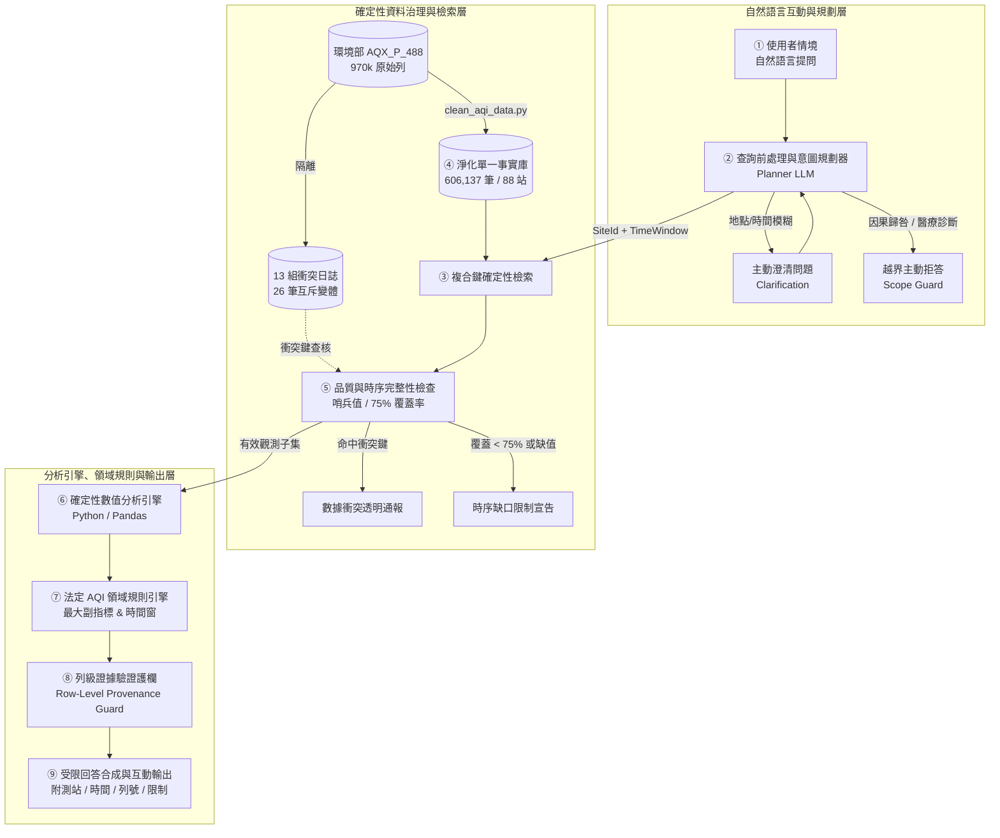
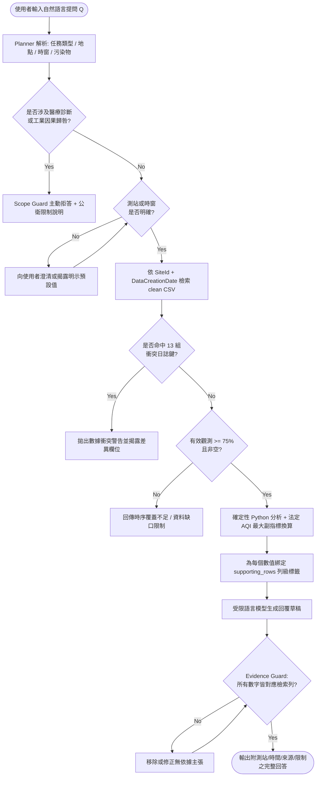

# 台灣空氣品質證據分析代理人（AirGuard AI）
## 期末專題提案書（Final Project Proposal Refactored）
**英文題目：** AirGuard AI: A Deterministic and Row-Level Provenance-Grounded Conversational Agent for Taiwan Air Quality Analysis

> **提案階段與學術誠信聲明（Proposal Stage & Academic Integrity Notice）**：本文件屬專題提案與 OpenSpec 規範重構階段（Proposal Stage），所有基準測試指標與比較預期均為「規劃驗證目標（Expected Outcomes / Planned Targets）」，尚未包含已執行之實驗數據。

---

## 第三部分：IEEE Transactions 期刊格式摘要（IEEE Transactions Systems Journal Style）

**Title—**AirGuard AI: A Deterministic and Row-Level Provenance-Grounded Conversational Agent for Taiwan Air Quality Analysis

**Abstract—**Air pollution remains a leading environmental threat to global public health, with the *State of Global Air 2025* report attributing 7.9 million deaths worldwide (approximately one in eight deaths) to pollutant exposure and the World Health Organization (WHO) noting that 99% of the global population breathes air exceeding guideline limits. In Taiwan, the Ministry of Environment (MOENV) tightened national air quality standards effective January 1, 2025—lowering the annual $\text{PM}_{2.5}$ threshold from 15 to 12 $\mu\text{g/m}^3$, enforcing station-by-station compliance, and advancing Air Quality Index (AQI) warnings—while afternoon photochemical ozone ($\text{O}_3$) increasingly drives Orange Alerts (AQI 101–150) across lee-side western basins. Although MOENV releases hourly historical station records (`AQX_P_488`), public and analytical usability is hindered by raw data inconsistencies, complex statutory sub-index rules, and the tendency of standalone large language models (LLMs) to hallucinate numeric values or emit unverified causal and clinical claims. To address these challenges, this paper proposes **AirGuard AI**, a domain-specific, provenance-grounded conversational AI agent that strictly decouples natural language orchestration from deterministic analytics. Based on a reproducible audit of 970,296 raw hourly observations (January–October 2026), the data pipeline resolves localized duplicates, recovers four uniquely mappable station identifiers, quarantines 13 conflicting station-time keys (26 variants), and establishes a single source of truth containing 606,137 unique records across 88 stations. During inference, a constrained LLM planner extracts structured query parameters and invokes deterministic Python tools, Taiwan MOENV maximum-sub-index AQI rules, a 75% daily temporal coverage validator, and a mandatory row-level provenance guard binding every numeric claim to its `(SiteId, DataCreationDate, SourceRowID)`. Furthermore, a scope guard enforces explicit abstention on industrial causal attribution and individualized medical diagnosis. A fixed 60-question benchmark (`AirGuard-Eval-60`) comprising 45 answerable queries and 15 boundary/abstention cases is designed to evaluate LLM-only baselines, deterministic tools alone, and the proposed agent on numeric accuracy, provenance linkage, unsupported-claim suppression, and abstention precision.

**Index Terms—**Air quality index (AQI), conversational AI, deterministic analytics, domain-specific AI agents, evidence grounding, large language models, provenance tracking, safety-aware systems.

---

## 第一與第二部分：摘要（Abstract）— A–F 六段式結構（Perplexity 實證強化版）

### A. Attention Getter（動機與最新權威數據引題）
空氣污染已成為全球最嚴峻的環境健康風險之一。根據 Health Effects Institute（HEI）於 2025 年發布的《全球空氣狀況報告》（*State of Global Air 2025*），全球約 **790 萬人死亡**（約佔全球總死亡人數的八分之一）與空氣污染暴露相關，其中 **86%（680 萬例）**源自心臟病、中風、慢性阻塞性肺病（COPD）等非傳染性疾病 [14]；世界衛生組織（WHO）2025 年科學與政策摘要（`B09461`）亦指出，全球約 **99% 人口**居住在空氣品質超過 WHO 指引限值的地區 [13]。在台灣，環境部於 2024 年 9 月 30 日修正發布《空氣品質標準》並自 **2025 年 1 月 1 日**正式施行：將 $\text{PM}_{2.5}$ 年平均標準由 $15$ 加嚴至 **$12\ \mu\text{g/m}^3$**、日平均由 $35$ 下修至 $30\ \mu\text{g/m}^3$，並將防制區認定改為更嚴格的「**站站達標**」，同時提前 2 至 4 小時觸發 AQI 預警門檻 [15]。儘管台灣近年全國 $\text{PM}_{2.5}$ 年均濃度已改善至約 $12.5\text{--}12.6\ \mu\text{g/m}^3$，2025 年新制上路後仍有 14 縣市列為 $\text{PM}_{2.5}$ 三級防制區，且氣候暖化與弱風背風沉降使**午後光化臭氧（$\text{O}_3$）**成為中南部（台中、雲嘉南、高屏）亮起「橘色提醒（AQI 101–150）」的主要推手 [15, 16]。然而，當民眾或研究者詢問「板橋測站上週三下午為何 AQI 突然轉為橘色提醒？主導污染物是 $\text{PM}_{2.5}$ 還是 8 小時臭氧？」時，面對環境部開放平臺（`AQX_P_488`）近百萬筆逐時原始資料，仍缺乏能即時給出**可核對、可追溯、合乎法定算則**之自然語言分析代理人 [9, 10]。

### B. But（挑戰與現有研究痛點）
現有解決路徑在實務與科學研究上面臨三重關鍵瓶頸：
1. **開放資料原生噪音與衝突風險**：針對 2026 年 1 月 1 日至 10 月 29 日 16 時之環境部 `AQX_P_488` 歷史月檔實測稽核顯示，原始 10 份 CSV 檔案共計 **970,296 列**（涵蓋 88 站），其中存在中英文欄位混雜與 **364,146 筆重複列**、`-`/`--`/`NA` 哨兵值、4 筆遺漏 `SiteId`，以及 **13 組（26 筆）同測站同時間卻數值互相矛盾的衝突紀錄**（涵蓋 `AQI` 8 組、`PM2.5_AVG` 8 組、`PM10_AVG` 5 組），未經治理直接分析將導致結論失真 [9]。
2. **通用 LLM 的表格忠實度幻覺（Faithfulness Hallucination）**：2024–2025 年表格式推理與 RAG 真實性基準（如 *TableBench*、*RAGTruth*）證實，大型語言模型雖擅長自然語言對話，但在處理大型表格與多步驟數值聚合時極易錯讀行列、產生算術漂移並捏造未見於檢索結果的數字與來源 [17, 18]。
3. **既有空品多代理系統無法直接移植**：2026 年 *npj Clean Air* 發表之 *Neuro-Air* [1] 雖證實多代理角色可執行端到端空品分析，但其資料聚焦香港與河北多源政策場景（317 題），未納入台灣環境部法定「最大副指標（Max Sub-index）」與 $\text{O}_3$ 8 小時／$\text{PM}_{2.5}$ 移動平均時間窗規範，亦未將「每一項數值主張強制綁定原始觀測列號」與「醫療／因果歸咎主動拒答」設為硬性系統契約。

### C. Cure（提案解藥）
為解決上述痛點，本專題提出 **AirGuard AI** —— 一個專為台灣歷史逐時空氣品質問答設計的「**確定性證據型領域智慧代理人（Deterministic Evidence-Grounded Domain AI Agent）**」。系統核心哲學為 **「LLM 負責意圖解析與語意組織，確定性工具負責檢索與計算，法定規則與護欄負責邊界檢查」**：LLM 嚴格受限於結構化規劃與受約束文字輸出，不直接計算數字或插值缺漏觀測；所有資料查詢、統計聚合、法定 AQI 換算與邊界判斷皆交由可稽核的 Python 確定性管線完成，並強制附加 `(SiteId, DataCreationDate, SourceRowID)` 列級來源標籤與資料限制說明。

### D. Development（方法設計與 OpenSpec SDD 規範化架構）
本專題將 `DESIGN.md` 轉換為可驗證的 **OpenSpec 規範驅動開發（SDD）** 工作流（`data-pipeline`、`agent-architecture`、`domain-rules`、`evaluation-benchmark` 四大規範），建構八模組閉環架構：
1. **資料治理與單一事實來源（SSOT）**：透過可重跑腳本 `scripts/clean_aqi_data.py` 以 `(SiteId, DataCreationDate)` 為主鍵合併雙語重複列、正規化哨兵值、依縣市與精確經緯度唯一對應補回 4 筆 `SiteId`，並將 13 組互斥衝突紀錄隔離至 `aqi_2026_conflicts.csv`，建立 **606,137 筆**純淨觀測庫（保留原始檔 MD5 校驗）。
2. **受限規劃與檢索分派**：Planner LLM 將提問解析為 `{site_id, time_window, pollutant, task_type}`，遇模糊測站或時段即觸發澄清（Clarification）；隨後進行確定性複合鍵檢索與衝突檢查。
3. **時間完整性與法定 AQI 規則引擎**：檢查單日有效觀測時數是否達 **75%（≥ 18/24 小時）** 門檻（不足則拒絕插值並回報缺口），並依環境部六大指標斷點公式計算副指標與最大副指標主導污染物，嚴格區分 `O3` 逐時值與 `O3_8hr` 滑動平均。
4. **列級證據與安全邊界護欄（Evidence & Scope Guard）**：比對輸出草稿中的每一項數值與檢索結果列號，刪除無依據宣稱；對「要求診斷個人氣喘用藥」或「指控特定工廠造成空污」等越界提問啟動主動拒答（Abstention）並提供中立公衛說明。

### E. Experiments（實驗評估規劃）
本研究設計固定 **60 題基準評估集（`AirGuard-Eval-60`）** 進行系統化驗證：
- **45 題正向可回答情境**：時序趨勢分析（15 題）、跨測站空間對比（15 題）、AQI 與主導污染物判定（15 題）。
- **15 題邊界與主動拒答情境**：感測器缺值與覆蓋率不足（5 題）、命中 13 組衝突紀錄（3 題）、工業排放因果歸咎（4 題）與個人醫療診斷諮詢（3 題）。
實驗將以確定性參考查詢產生之標準答案（並經人工抽核測站、時間與法規解釋）作為 Ground Truth，對照三組條件：(1) **LLM-only 無檢索直接生成**、(2) **Deterministic Tools Only 純表格輸出**、(3) **AirGuard AI 領域代理人**；主要評估指標為容許誤差內數值正確率、列級來源對應正確率、無來源主張率（幻覺率目標 0.0%）及邊界限制／拒答精準率。

### F. Findings（預期產出、學術價值與 A–F 自我補強檢視）
#### 1. 預期產出（Expected Outcomes — Proposal Stage Only）
嚴格遵循「未實測前不虛構實驗結果」準則，本專題預期達成：
- 在 45 題可回答基準上，於高語言可讀性下維持與確定性工具一致的高數值正確率（預期目標 >90%）；
- 所有數值主張之列級來源（測站、時間戳、原始列號）對應正確率達 **100%**，無來源數值幻覺率壓低至 **0.0%**；
- 在 15 題缺值、衝突與越界因果／醫療提問中，準確觸發限制宣告或拒答（預期目標 >90%）。

#### 2. 預期貢獻與學術價值（Expected Contributions & Academic Value）
1. **台灣在地開放空品資料之可重現治理標準**：首度針對 2026 年環境部 `AQX_P_488` 近百萬筆實測檔完成系統化稽核，建立雙語去重、哨兵正規化與 13 組數值衝突隔離之標準管線。
2. **低成本、可稽核之「語意—計算—規則」解耦代理人範式**：相較於複雜且具代碼執行漂移風險的自主多代理拓撲，驗證以小型受限 Planner 搭配固化確定性工具與列級驗證護欄即可實現零數值幻覺之科學問答。
3. **落實法規約束與公衛安全邊界之 AI 治理實踐**：將台灣 2025 年加嚴空品標準、最大副指標算則、75% 時序有效率門檻與「相關性非因果／固定站非個人暴露」護欄轉化為可測試的 OpenSpec 規範契約。
4. **可複現之台灣空品問答基準集（`AirGuard-Eval-60`）**：補齊現有研究缺乏「正向趨勢對比 + 異常衝突／越界拒答」雙軌檢驗之評估缺口，提供後續環境 AI 代理人研究之基準參照。

#### 3. A–F 補強自評與重寫強化重點（Review & Refinement Notes）
相較於初版摘要僅描述技術模組，本次重寫依據 Perplexity 實證檢索進行了四項關鍵強化：(1) 在 **A** 導入 2025 年 *State of Global Air*（790 萬死亡／86% NCDs）、WHO 2025 `B09461`（99% 人口超標）及台灣環境部 **2025 年 1 月 1 日生效之 $\text{PM}_{2.5}$ $12\ \mu\text{g/m}^3$ 新制與午後臭氧橘色提醒案例**，大幅提升研究時效性與社會迫切感；(2) 在 **B** 將籠統的「資料雜亂」具象化為可核對的稽核數據（970,296 列 → 364,146 重複列 → 13 組衝突鍵），並引用 2024–2025 表格幻覺基準（*TableBench* / *RAGTruth*）補強理論依據；(3) 在 **C–D** 明確對接 OpenSpec SDD 規範與 `DESIGN.md` 九階段工作流；(4) 在 **E–F** 嚴守學術誠信，明訂所有量化指標均屬待驗證之規劃目標，絕不提前捏造實驗分數。

---

## 第二部分（續）：300 字重點精華摘要（300-Word Condensed Summary）

> 空氣污染威脅全球健康，2025 年《全球空氣狀況報告》指出每年約 790 萬人死亡與空污相關，台灣環境部亦於 2025 年起將 $\text{PM}_{2.5}$ 年均標準加嚴至 $12\ \mu\text{g/m}^3$ 並推動「站站達標」與臭氧預警管理。然而，環境部公開逐時資料（`AQX_P_488`）存在近百萬筆觀測、雙語重複、缺值哨兵與互斥衝突紀錄，且通用 LLM 直接問答極易產生表格計算幻覺與無來源宣稱。為此，本專題提出 **AirGuard AI**——一套基於 OpenSpec 規範驅動開發之台灣空品證據分析代理人。系統採「語意規劃與數值計算解耦」設計：由受限 Planner 解析提問並分派任務，結合經清洗與隔離 13 組衝突鍵後的 606,137 筆（88 站）單一事實庫，透過 Python 確定性引擎執行運算並套用環境部最大副指標與 75% 日覆蓋門檻，再以列級證據護欄強制將每個數字綁定原始列號，並主動拒答醫療診斷與工廠因果歸咎。評估將以 60 題基準集對照 LLM-only 與純工具輸出，預期在保留自然語言易讀性的同時，達成零無來源數值幻覺與 100% 證據可追溯性。

---

## 1. 緒論 (Introduction) — G–L 六段式結構

### G. General (背景現況)
隨著環境流行病學研究的累積，空氣污染的健康代價已獲得全球共識。世界衛生組織 (WHO) 2021 年發布全球空品指引，並於 2025 年科學與政策摘要（`B09461`）重申空污暴露與全球約八分之一死亡及非傳染性疾病密切相關 [12, 13]；*State of Global Air 2025* 進一步量化全球每年約 790 萬例死亡歸因於空氣污染，且近 99% 全球人口曝露於超越 WHO 基準的大氣環境 [13, 14]。在台灣，面對東亞季風、中央山脈地形與西部工商業密集排放交互影響，環境部自 2025 年 1 月 1 日起全面施行加嚴後之《空氣品質標準》（$\text{PM}_{2.5}$ 年均標準降至 $12\ \mu\text{g/m}^3$、採「站站達標」判定）並同步調嚴 AQI 警示門檻 [15]；與此同時，台灣空氣品質監測網開放平臺（`AQX_P_488`）持續釋出全台 88 座標準測站之逐時歷史觀測，涵蓋 AQI、$\text{SO}_2$、$\text{CO}$、$\text{O}_3$、$\text{PM}_{10}$、$\text{PM}_{2.5}$、$\text{NO}_2$ 及風速風向等欄位 [9]，成為推動公眾環境知情權與資料科學應用的重要基石。

### H. However (核心挑戰與四大障礙)
然而，一般民眾、學生與環境研究者在實際使用開放空品資料進行日常查詢或時空分析時，仍面臨四項結構性障礙：
1. **資料檢索與預處理門檻極高**：以 2026 年 1 至 10 月份下載之 `AQX_P_488` 十份月檔為例，原始資料高達 970,296 列，混雜中英文欄位標籤、負值/文字哨兵（`-`, `--`, `NA`）與四筆遺漏 `SiteId` 之紀錄，非工程背景使用者難以自行對齊測站與時間窗 [9]。
2. **原生資料庫存在數值衝突紀錄**：實測清理發現 2026 年 9 月份資料出現 13 組（26 筆）同測站、同時間戳記卻記錄了相異 `AQI`、`PM2.5_AVG` 或 `PM10_AVG` 之衝突列；若系統未主動偵測隔離而逕行平均或取第一筆，將產生自相矛盾的偽證結論。
3. **生成式 AI 存在表格計算與引用幻覺**：純 LLM 本質為機率自回歸文字模型，在跨多列時間序列聚合（如計算某週均值、極值或測站排名）上容易產生算術漂移，且常在無檢索依據下捏造測站讀值或錯誤引用時間 [17, 18]。
4. **領域概念混淆與越界歸因風險**：使用者易忽略環境部 AQI 採「六大指標取最大值」且各自對應不同滑動平均窗口（如 `O3_8hr` 與逐時 `O3`、`PM2.5_AVG`）之規範 [10]，亦常將「固定環境站讀值」誤讀為「個人實際吸入暴露劑量」，或將「下風處濃度升高」武斷推論為「特定工廠排污之法律因果證明」[1, 11, 13]。

### I. In Literature (文獻中現有解法分類)
回顧現有國內外空品資訊系統與 AI 分析研究，可由簡入繁歸納為三大路徑：
1. **路徑一：官方靜態監測門戶與公開視覺化儀表板**：如環境部空氣品質監測網 [10]。優勢為資料具法定權威性；劣勢為查詢介面固定，無法理解複合自然語言時空提問（如「比較板橋與新莊上週午後臭氧升幅」），亦不自動產出跨日趨勢統計摘要。
2. **路徑二：數值預測模型與低成本感測器校正（ML Forecasting & Calibration）**：如 Lee 等人 (2020) 以梯度提升機結合地形氣象預測台灣 $\text{PM}_{2.5}$ [4]；Tzeng 等人 (2023) 以空間變動係數 (SVC) 模型校正台灣 AirBox 微型感測網 [5]；Dong 等人 (2025)、Fang 等人 (2025) 與 Lekamge 等人 (2025) 則深入剖析低成本感測器在實地共置、鏡面老化與高濕度吸濕散射下之偏差極限 [6, 7, 8]。此類研究聚焦數值回歸與感測誤差修正，並不處理自然語言問答與列級證據追溯。
3. **路徑三：LLM 異常偵測與多代理決策系統（LLM & Multi-Agent Systems）**：如 Lee 等人 (2025) 結合 DTW 時序相似度與生成式模型解說韓國監測網異常 [2]；Yenkikar 等人 (2025) 以 RF + ARIMA + SHAP 建立可解釋 AQI 預測 [3]；Ma 等人 (2026) 於 *npj Clean Air* 發表 Neuro-Air 多代理系統處理香港與河北 317 道空品分析任務 [1]。這類系統展現了代理工作流潛力，但尚未針對台灣法定 AQI 規範、本地 `AQX_P_488` 衝突隔離與硬性列級溯源進行系統化基準驗證。

### J. Judgement (各類方法 SWOT 批判分析與研究缺口)
對上述三大路徑進行批判性 SWOT 評析：
- **官方儀表板 (S/W)**：優勢為法定真值權威；劣勢為互動僵化，無法執行開放式自然語言時序比較與自動解釋。
- **機器學習預測／校正模型 (S/W)**：優勢為針對特定測點之誤差改善（如 SVC 降低 RMSE 38%–68%）；劣勢為缺乏自然語言推理與法規解讀介面，且低成本感測器易受濕度與環境退化影響而難以跨站泛化 [6, 7, 8]。
- **通用／多代理 LLM 系統 (O/T)**：機會在於透過工具調用打通自然語言與資料分析；威脅在於多代理動態生成代碼容易出現執行漂移（Code Execution Drift）、無聲插值缺漏時段，或回應越界因果與臨床診斷提問 [1, 17]。

**收斂出之 Research Gap (研究缺口)**：
> 在現有文獻檢索範圍內，**尚缺乏一套針對台灣環境部 `AQX_P_488` 歷史資料品質條件（雙語重複、哨兵缺值、互斥衝突鍵），結合台灣法定最大副指標 AQI 規則與 75% 時序覆蓋檢查，並將自然語言規劃、確定性 Python 運算與強制列級證據護欄嚴格解耦的領域智慧代理人與基準評估集**。

### K. Keypoint (設計精神、創新點與四大預期貢獻)
AirGuard AI 秉持 **「語言歸語言、計算歸確定性、結論歸證據」** 之核心精神，並不宣稱發明通用多代理演算法，而是提出一套高度可靠、可稽核、可重現之台灣空品證據代理人架構。
**四大主要貢獻**：
1. **建立端到端可重跑的 `AQX_P_488` 資料治理流程**：保存原始檔與 MD5 校驗，完成 970,296 列資料之去重、4 筆 `SiteId` 唯一座標修復與 13 組互斥衝突鍵安全隔離，產出 606,137 筆單一事實觀測庫。
2. **實作 OpenSpec SDD 規範化之解耦領域代理人**：將 `DESIGN.md` 轉換為 `openspec/specs/` 四大能力契約，限制 LLM 僅執行意圖解析與文字組織，所有數值皆由確定性腳本產出。
3. **建置列級證據回溯與雙重安全護欄**：強制每個數值主張綁定 `(SiteId, DataCreationDate, SourceRowID)`，並落實 75% 覆蓋門檻、衝突告警與醫療／因果拒答防線。
4. **構建 60 題基準評估集 (`AirGuard-Eval-60`)**：系統性對比 LLM-only、純確定性工具與 AirGuard AI 在數值精度、證據忠實度與邊界拒答上的表現與失敗模式。

### L. List the Organization (章節結構導覽)
本提案書後續章節安排如下：
- **第 2 節（Related Work & Deep Research）**：依「1/2 AI 技術 + 1/2 領域知識」彙整 8 篇核心文獻 [1–8] 並建立 4x5 綜合比較表，接續展開 5 個核心思維模式、3 個專業爭論取捨與 10 個深度理解問題；
- **第 3 節（Proposed Scheme, PA–PM）**：呈現轉換自 OpenSpec 的系統架構圖（對齊八大模組與九階段工作流）、操作流程圖（Flowchart）、數學公式與帶行號演算法虛擬碼（Pseudocode）；
- **第 4 節（Experiments & Evaluation Plan, Q–V）**：定義 60 題測試集組成、三組比較基準與量化指標；
- **第 5 節（Conclusion, W–Z）**：總結專題定位、階段限制與未來擴展方向；
- **第 6 節（References）**：完整列出經查核之文獻 DOI 與官方資料來源。

---

## 2. 相關研究 (Related Work) 與 Deep Research 深度調研

### M. Methods (文獻方法分類：1/2 AI 技術 + 1/2 領域知識)
本節嚴格遵循「二分之一 AI 技術 + 二分之一空品量測領域知識」原則，涵蓋 2020 至 2026 年間發表之 8 篇代表性期刊論文：

#### 【AI 與資料分析面向 (4 篇)】
1. **多代理空品分析決策系統**：Ma 等人 (2026) 於 *npj Clean Air* 提出 **Neuro-Air** [1]，協同檢索、編程與審查等多個 LLM 角色於 Python 環境執行香港與河北之多源空品決策支援（317 道複雜問題），證明端到端工具協同之可行性，但同時提醒程式執行正確並不等同於環境領域空間歸因與健康推論正確。
2. **時序異常偵測與生成式解說**：Lee 等人 (2025) 於 *IEEE Access* [2] 結合序列切片、Dynamic Time Warping (DTW)、Z-score 與生成式語言模型於韓國國家空氣品質監測網進行異常偵測，在維持高召回率下降低逾 50% 誤報率。
3. **可解釋性 AQI 混合預測**：Yenkikar 等人 (2025) 於 *MethodsX* [3] 結合 Random Forest、ARIMA 與 SHAP 可解釋性歸因預測印度城市 AQI 時序，取得 $R^2 = 0.94$（MSE 508.46），展現統計特徵歸因價值。
4. **台灣本島高解析度 $\text{PM}_{2.5}$ 預測**：Lee 等人 (2020) 於 *Scientific Reports* [4] 整合台灣 77 座環保署測站與 580 座氣象站資料（2012–2017），利用 Gradient Boosting 結合地形與電廠特徵達成 $R^2 = 0.71$ 之濃度預測。

#### 【空品量測、感測器校正與領域規範面向 (4 篇)】
5. **台灣 AirBox 微型感測器空間校正**：Tzeng 等人 (2023) 於 *Biometrics* [5] 針對台灣官方 TAQMN 與微型感測器 AirBox 提出空間變動係數 (SVC) 模型，於 2020 逐時資料中將 $\text{PM}_{2.5}$ RMSE 改善 38%–68% 並提供空間不確定區間。
6. **低成本感測器實地共置校正極限**：Dong 等人 (2025) 於 *Science of the Total Environment* (STOTEN) [6] 比較多種線性與非線性機器學習模型在參考站共置下的表現，證實溫濕度修正成效高度依賴環境與感測器型號，非線性模型極易過擬合且無法跨站遷移。
7. **部署前後環境因子與感測器老化漂移**：Fang 等人 (2025) 於 *STOTEN* [7] 追蹤 11 戶 19 顆 Plantower 低成本監測器之部署前後曲線變化，證實長期濕度與累積暴露會顯著改變校正斜率與截距。
8. **高濕度吸濕性氣膠光學偏差修正**：Lekamge 與 Oswin (2025) 於 *npj Climate and Atmospheric Science* [8] 透過雙感測器（含乾燥管對照）分析 PMS7003 光學偏差，證實高濕度下低成本微粒讀值可能高估達 25%–40%。

### N. New Proposed (本專題之切入視角與新穎性)
相較於上述研究致力於複雜預測回歸、微型站空間插補或高自主性多代理寫碼，AirGuard AI 鎖定尚未被填補的 **「台灣法定開放歷史資料之可追溯證據問答」**：
1. **資料治理優先於生成**：先完成 970,296 列原生檔案之去重與 13 組數值衝突隔離，確保知識庫零污染；
2. **確定性運算取代代理動態寫碼**：將所有趨勢、排名、變化量與法定 AQI 斷點換算固化於單元測試覆蓋之 Python 工具；
3. **強制列級證據綁定與邊界拒答**：從架構上保證每一個輸出數字均可追蹤至實體測站列號，並依法規與科學邊界主動攔截無效與越界提問。

### O. Organize (4x5 綜合文獻比較表與研究缺口)

| 文獻標號與年份 | 研究問題與目標 | AI / 資料分析方法 | 領域知識核心概念 | 驗證資料集與規模 | 核心研究發現 | 本專題相關限制與差距 |
|---|---|---|---|---|---|---|
| **[1] Ma et al.<br>(2026, npj)** | 跨區域多來源空氣品質分析與決策支援 | LLM 多代理角色協調 + Python 執行沙箱 | 排放清冊、氣象擴散與環境政策評估 | 香港與河北多源觀測 (317 道分析任務) | 多步驟代碼執行可協助複雜分析；空間與暴露推論仍需專家審核 | 資料與法規不符台灣 AQI；未將每項數值強制綁定單一觀測列號 |
| **[2] Lee et al.<br>(2025, IEEE)** | 空品監測網時序異常偵測與語意解釋 | 序列切片 + DTW / Z-score + 生成式語言模型 | 空品時序物理連續性、鄰近測站空間一致性 | 韓國國家空氣品質監測網逐時資料 | 維持高召回率前提下，將異常誤報率 (FPR) 降低超過 50% | 聚焦單點異常標記；未支援自然語言複合問答與列級來源驗證 |
| **[3] Yenkikar et al.<br>(2025, MethodsX)** | 城市 AQI 數值預測與特徵重要度歸因 | Random Forest + ARIMA 混合預測 + SHAP | 污染物跨日傳輸相依性與線性／非線性權重 | 印度多測站空氣品質時序資料集 | 混合模型達 MSE 508.46、$R^2 = 0.94$，優於單一統計模型 | 屬數值預測任務，無法回答使用者特定地點時段之歷史查證問題 |
| **[4] Lee et al.<br>(2020, Sci. Rep.)** | 台灣全島測站級高解析度 $\text{PM}_{2.5}$ 濃度預測 | 梯度提升機 (GBM) + 多源氣象空間特徵 | 台灣盆地山脈地形、季風路徑與電廠點源 | 全台 77 環保署站 + 580 氣象站 (2012–2017) | 納入局部氣象與電廠特徵後，$\text{PM}_{2.5}$ 預測 $R^2$ 達 0.71 | 僅提供回歸預測，不具備自然語言問答介面與法定 AQI 多指標解讀 |
| **[5] Tzeng et al.<br>(2023, Biometrics)** | 台灣 AirBox 微型感測網空間統計校正 | 空間變動係數 (SVC) 模型 + 空間不確定度 | TAQMN 參考站基準、微環境空間異質性 | 2020 全台逐時環保署與 AirBox 觀測資料 | 顯著修正微型感測器偏差，RMSE 改善 38%–68% | 僅針對 $\text{PM}_{2.5}$ 單一指標；統計校正模型無法直接用於官方合規判定 |
| **[6] Dong et al.<br>(2025, STOTEN)** | 低成本氣體／微粒感測器實地共置校正評估 | 線性／非線性回歸與隨機森林 + Bland-Altman | 電化學交叉敏感性、溫濕度干擾與過擬合風險 | 澳洲墨爾本參考站共置 TSI 感測器數據 | 非線性 ML 校正易過擬合且溫濕度修正無法跨站穩定遷移 | 證實低成本感測器環境依賴強，不可未經校正直接取代官方測站 |
| **[7] Fang et al.<br>(2025, STOTEN)** | 低成本光學感測器部署前後性能衰退分析 | 實驗室氣膠室標定 + 部署前後回歸比較 | 光學感測器污染漂移與累積暴露老化 | 美國猶他州 11 戶 19 顆 Plantower 感測器 | 長期溫濕度與累積暴露會顯著改變感測器斜率與截距 | 證明微感測器具時效退化特性，不宜作為評估真值基準 |
| **[8] Lekamge & Oswin<br>(2025, npj)** | 高濕度環境下光學微型感測器濕度偏差修正 | 乾燥對照雙感測器 + 滾動校正因子 | 吸濕性氣膠潮解效應與米氏光散射高估 | 澳洲布里斯本 PMS7003 連續長期觀測 | 除濕對照可降低高濕環境下 $\text{PM}_{2.5}$ 高估偏差約 25%–40% | 仍屬實驗性校正框架，缺乏跨季節與化學組成普適驗證 |

---

### Deep Research 深度調研三大問題解析

#### Q1. 五個核心思維模式 (5 Core Mental Models)
1. **多污染物最大副指標思維（Max Sub-index Principle）**：
   台灣環境部 AQI 採用「木桶理論」，以六大標準污染物換算副指標後取最大值作為測站 AQI [10]。單一 AQI 數字容易遮蔽其餘污染物變化。*系統設計落實*：AirGuard AI 在回覆 AQI 時強制併列「主導污染物（Governing Pollutant）」與該污染物之實測濃度及單位。
2. **測站空間代表性與個人暴露解耦（Spatial Representativeness vs. Personal Exposure）**：
   國家參考測站設於特定高度與周邊環境，反映數公里尺度之區域環境背景濃度，不等同於民眾在巷弄、室內或通勤車陣中之個人吸入暴露劑量 [11, 13]。*系統設計落實*：嚴格禁止輸出「您目前吸入 X 微克」等個人暴露宣稱，一律界定為「區域測站監測背景值」。
3. **感測器階級與資料品質分層（Sensor Hierarchy & Data Tiering）**：
   參考級測站（TAQMN）與民營低成本物聯網（AirBox）在光學原理、校驗週期與濕度敏感度上存在顯著落差 [6, 7, 8, 11]。*系統設計落實*：將環境部 `AQX_P_488` 列為 Tier-1 唯一真值來源；未經共置校驗之低成本感測資料不納入核心問答真值。
4. **時間尺度對齊與滑動平均規範（Temporal Scale Alignment & Moving Windows）**：
   法規對不同污染物定義不同平均窗（如臭氧取 `O3_8hr` 或逐時 `O3`、$\text{PM}_{2.5}$ 取加權移動平均、$\text{NO}_2$ 取逐時值），且 WHO 指引嚴格區分短期與長期暴露 [10, 12]。*系統設計落實*：在資料字典與計算管線中將 `O3` 與 `O3_8hr` 設為隔離欄位，並強制要求單日有效時數達 75%（18/24 小時）才計算日統計。
5. **時空相關性與因果歸咎防線（Correlation vs. Causal Attribution）**：
   測站風向改變與下風處濃度升高僅構成時空伴隨證據，缺乏大氣擴散傳輸模式（如 CMAQ/AERMOD）與即時排放清冊前，無法構成特定工廠排污或個人臨床病因之科學因果證明 [1]。*系統設計落實*：Scope Guard 將責任歸咎與醫療診斷列為明確拒答邊界。

#### Q2. 三個重要專業爭論與架構取捨 (3 Professional Trade-offs)
1. **爭論一：低成本物聯網感測網路 vs. 國家參考級監測網**
   - *支持微感測擴張*：佈建密度高、成本低，搭配 SVC 空間統計校正可改善局部 $\text{PM}_{2.5}$ 估計誤差 38%–68% [5]。
   - *堅持參考站為核心*：2025 年多篇 STOTEN 與 npj 研究證實低成本感測器受高濕吸濕偏差（25%–40%）、長期老化與跨站過擬合制約 [6, 7, 8]；U.S. EPA 指引亦不將其視為法定合規標準 [11]。
   - *共識與本專題取捨*：微型感測器僅適合作為輔助參考。本專題優先鎖定環境部官方 `AQX_P_488` 作為 Tier-1 黃金基準，確保法定數值一致性。
2. **爭論二：自主生成代碼之端到端代理（End-to-End Agent）vs. 確定性工具解耦架構**
   - *支持高自主代理*：能動態撰寫 Python 腳本應對非預期複合任務（如 Neuro-Air）[1]。
   - *支持確定性固化工具*：LLM 動態寫碼存在語法/邏輯漂移風險，在缺值或衝突紀錄下可能擅自補值；表格幻覺研究亦指出大模型對數值聚合極易出錯 [17]。
   - *共識與本專題取捨*：將語意解析與數值計算徹底解耦，全數統計與 AQI 換算採用預先測試之確定性函式庫，以換取 100% 稽核重現性。
3. **爭論三：高度個人化健康風險評估 vs. 通用公衛防護指引**
   - *支持個人化評估*：結合年齡、慢性病史與所在位置給出專屬防護建議，能提升健康應用價值。
   - *堅持公衛基線防線*：在缺乏臨床生理數據與醫師介入下，AI 給出個人用藥或病理診斷涉及醫療法規責任與誤導風險。
   - *共識與本專題取捨*：僅輸出環境部與 WHO 官方分級活動建議（如橘色提醒建議敏感族群減少戶外劇烈活動），對臨床診斷提問強制觸發安全拒答。

#### Q3. 十個深度理解問題 (10 Deep Implementation & Domain Details)
1. **[Why] 為何必須將自然語言解析與數值計算徹底分離？**
   LLM 透過詞元機率分佈運作，缺乏算術邏輯單元（ALU）的精確性；面對上千筆逐時觀測時，直接推理必然引發浮點漂移與表格忠實度幻覺 [17]，唯有交由確定性 Python 工具計算才能保證 100% 數學一致。
2. **[What-if] 若使用者查詢剛好命中清理階段隔離的 13 組互斥衝突紀錄，系統如何回應？**
   Retrieval 與 Quality Filter 在檢測到 `(SiteId, DataCreationDate)` 命中 `aqi_2026_conflicts.csv` 時，不隨機挑值亦不取平均，而是主動拋出「數據衝突警示」，明確揭露原始雙版本差異欄位，確保資訊誠實。
3. **[Trade-off] 為何在提案評估原型中選擇離線歷史快照 (`AQX_P_488`) 而非即時 API (`AQX_P_432`)？**
   科學基準測試（60 題對比）要求嚴格「可重現性（Reproducibility）」；即時 API 受網路延遲、跨月滾動覆寫與未品保流式異常影響，無法構成三組實驗條件之公平對照基準。
4. **[Failure Case] 當使用者提出誘導性問題（「XX 石化廠昨晚排氣害我氣喘發作，請幫我驗證」），防線如何動作？**
   Planner 標記出「工業因果歸咎」與「個人醫療診斷」雙重越界標籤，Scope Guard 即刻中斷分析並回傳規範化拒答聲明，釐清固定測站不具備因果溯源與臨床診療效力。
5. **[Evidence Grounding] 列級證據護欄（Row-Level Evidence Guard）如何在程式層級落實？**
   確定性引擎回傳每個統計指標時同步封裝 `supporting_rows: List[(SiteId, DataCreationDate, SourceRowID)]`；Evidence Guard 透過正規表達式與結構化欄位核驗回覆中的每個數值，任何未對應至檢索列號之數字均予剔除。
6. **[Comparison] AirGuard AI 與 2026 *npj Clean Air* 之 Neuro-Air 本質差異為何？**
   Neuro-Air 採多代理動態生成 Python 代碼以應對香港與河北宏觀政策決策；AirGuard AI 則聚焦台灣在地法規問答，捨棄動態寫碼不可控性，導入台灣最大副指標算則與強制列級引用檢驗。
7. **[Design Decision] 為何資料主鍵強制使用 `(SiteId, DataCreationDate)` 而絕不用測站中文名稱關聯？**
   環境部歷史 CSV 存在中英文雙語重複列與站名格式差異（如站名後綴變化），以法定唯一代碼 `SiteId` 結合時間戳記建鍵可杜絕字串模糊匹配造成的跨站錯置，並成功靠縣市與精確經緯度救回 4 筆缺失 `SiteId` 之觀測。
8. **[Real-world Scenario] 若颱風停電或儀器校驗造成單日連續缺值（`-` 哨兵值達 10 小時），如何計算日趨勢？**
   Quality Filter 依據 75% 時序完整性規則（單日需 $\ge 18$ 筆有效小時紀錄），發現有效率僅 $14/24 = 58.3\%$ 時即主動標註「時序覆蓋不足」，拒絕進行內插猜測。
9. **[Domain Rule] 法定 `O3_8hr` 八小時移動平均與逐時 `O3` 濃度在預警判讀上如何避免混淆？**
   午後光化反應生成之臭氧高峰具瞬間刺激與累積效應雙重意義，法定 AQI 主要以 `O3_8hr`（或特定高濃度逐時值）換算副指標 [10]；系統於結構化查詢層嚴格區隔兩欄位並於回覆標明時間窗。
10. **[Evaluation Metric] 在 60 題基準評估中，如何客觀量化「數值正確率」與「證據忠實度」？**
    數值正確率依任務定義容差（連續濃度 $\pm 0.1\ \mu\text{g/m}^3$、整數 AQI 需完全吻合）；證據忠實度則定義為回答中成功綁定真實檢索列號之數值主張佔所有數值主張之比例（目標值 100%，無來源主張率目標 0.0%）。

---

## 3. 系統架構與工作流 (Proposed Scheme) — PA–PM 設計標準

### PA. Aim / Statement (專案目標)
建立台灣首個針對環境部 `AQX_P_488` 逐時歷史監測資料之「OpenSpec 規範化、確定性運算、列級可稽核」領域智慧代理人，降低民眾與研究者查核在地空品趨勢與臭氧／微粒預警之認知門檻，同時杜絕語言模型數值幻覺。

### PB. Based on (依據基礎)
本設計奠基於台灣環境部 `AQX_P_488` 開放資料架構 [9]、2025 年修正施行之台灣《空氣品質標準》與法定 AQI 斷點演算法 [10, 15]、U.S. EPA 感測器品質與選址指引 [11]、WHO 2021/2025 空氣品質與健康暴露報告 [12, 13]，以及 OpenSpec Spec-Driven Development (`openspec/specs/`) 工程契約。

### PC. Cure & Cause (機制有效原理)
「語意理解與數值計算分離」消除了神經語言模型直接執行算術造成的浮點漂移；「前置雙語去重與 13 組衝突隔離」確保單一事實來源（SSOT）不受汙染；「強制列級綁定與 75% 時序門檻」則從架構端攔截無依據宣稱與缺值誤導。

### PD. Design (系統架構與 OpenSpec 工作流映射)
本系統將 `DESIGN.md` 九個處理組件嚴密映射至課程規範之八大核心階段（並於 `openspec/changes/proposal-refactor/design.md` 落地為標準工作流）：



### PE. Paper Elements (系統模組清單 — 對齊 `DESIGN.md` 與八大模組規範)
1. **User/Application Interaction（使用者互動情境）**：接收關於台灣特定測站、時段、污染物比較之自然語言提問，並呈現附帶來源與限制之回答。
2. **Query/Input Processing & Planner（意圖規劃與前處理）**：解析測站、時間窗、目標污染物與任務類型（趨勢／測站比較／AQI 解讀）；遇不明確輸入觸發澄清，遇醫療／因果提問轉交邊界護欄。
3. **Deterministic Data Acquisition & Retrieval（資料取得與複合鍵檢索）**：依據 `(SiteId, DataCreationDate)` 索引查詢經 `clean_aqi_data.py` 治理產出之 `aqi_2026_clean.csv`（606,137 筆）並比對 `aqi_2026_conflicts.csv`。
4. **Quality & Temporal Alignment Filter（品質與時序對齊濾波）**：驗證台灣時區語意、`NA`/`-` 哨兵空值與單日 $\ge 75\%$（18/24 小時）有效覆蓋門檻，拒絕任意插值。
5. **Deterministic Analytics Engine（確定性數值分析引擎）**：透過 Python/Pandas 計算區間均值、變化量、極值、持續性基準與跨站排名，絕不由 LLM 心算。
6. **MOENV AQI Domain Knowledge Engine（法定領域規則引擎）**：計算六大指標副指標與最大副指標主導污染物，嚴格區分 `O3_8hr`、`CO_8hr`、`PM2.5_AVG` 與逐時欄位。
7. **Evidence & Scope Guard（決策核驗與邊界護欄）**：強制將草稿中之每個數值綁定 `(SiteId, DataCreationDate, SourceRowID)`，剔除無依據宣稱並執行公衛安全邊界攔截。
8. **Constrained Output & Interaction（受限輸出與視覺互動層）**：生成簡明結構化回覆，完整揭露測站代碼、觀測時間窗、數值單位、資料來源與未知限制。

### PF. Formulation (演算法與數學公式)
1. **個別污染物副指標線性內插公式**（依環境部法定斷點表 [10]）：
   $$I_p = \frac{I_{\text{high}} - I_{\text{low}}}{C_{\text{high}} - C_{\text{low}}} \times (C_p - C_{\text{low}}) + I_{\text{low}}$$
   其中 $C_p$ 為對應平均時間窗之污染物濃度，$[C_{\text{low}}, C_{\text{high}}]$ 與 $[I_{\text{low}}, I_{\text{high}}]$ 分別為濃度與指標斷點區間。
2. **測站總體 AQI 與主導污染物定義**：
   $$\text{AQI} = \max \{ I_{\text{PM2.5}}, I_{\text{PM10}}, I_{\text{O3}}, I_{\text{CO}}, I_{\text{SO2}}, I_{\text{NO2}} \}, \quad P_{\text{governing}} = \arg\max_{p \in \text{Pollutants}} (I_p)$$
3. **日資料時序覆蓋有效率**：
   $$\text{CoverageRate}(s, d) = \frac{N_{\text{valid\_hours}}(s, d)}{24} \ge 0.75 \quad (\text{即至少 } 18 \text{ 小時非缺值觀測})$$
4. **證據忠實度（Provenance Faithfulness）**：
   $$\text{Faithfulness} = \frac{\sum_{i=1}^N \mathbb{I}(\text{Claim}_i \text{ matches } \text{RetrievedRow}_i)}{\sum_{i=1}^N \mathbb{I}(\text{Claim}_i \text{ is numeric})}$$

### PG. Graph & PI. Implementation (系統操作流程圖與含行號演算法虛擬碼)



```python
"""
Algorithm 1: AirGuard AI — Deterministic Evidence-Grounded Air Quality Agent
Input : User Query Q, Clean Dataset D_clean (606,137 rows), Conflict Log D_conflict (13 keys)
Output: Provenance-Verified Response R
"""
 1: function RunAirGuardAgent(Q, D_clean, D_conflict):
 2:     # 步驟 1: 解析使用者查詢結構與越界特徵
 3:     plan = Planner.Parse(Q)  # {site_id, time_window, pollutant, task_type}
 4:     if plan.requests_medical_advice or plan.requests_causal_attribution:
 5:         return ScopeGuard.GenerateAbstentionResponse(plan.boundary_type)
 6:
 7:     # 步驟 2: 驗證測站編號與支援時窗 (2026-01-01 ~ 2026-10-29)
 8:     if not StationResolver.IsValid(plan.site_id) or not TimeResolver.IsValid(plan.time_window):
 9:         return Planner.RequestClarificationOrDefault(plan)
10:
11:     # 步驟 3: 確定性複合鍵檢索與衝突隔離檢查
12:     conflicts = D_conflict.Lookup(plan.site_id, plan.time_window)
13:     if conflicts.not_empty():
14:         return QualityFilter.GenerateConflictNotice(conflicts)
15:
16:     records = D_clean.Retrieve(plan.site_id, plan.time_window)
17:     if len(records) == 0 or records.CoverageRate() < 0.75:
18:         return QualityFilter.GenerateDataGapResponse(records.CoverageRate())
19:
20:     # 步驟 4: 確定性數值運算與台灣法定 AQI 規則換算
21:     stats = DeterministicAnalytics.Compute(records, plan.task_type, plan.pollutant)
22:     aqi_eval = MOENVRuleEngine.EvaluateMaxSubIndex(records)  # 區分 O3_8hr 與 O3
23:
24:     # 步驟 5: 強制列級證據綁定
25:     evidence_table = []
26:     for metric in stats.metrics():
27:         row_ref = records.FindSupportingRow(metric.site_id, metric.timestamp, metric.field)
28:         evidence_table.append({
29:             "value": metric.value,
30:             "unit": metric.unit,
31:             "site_id": metric.site_id,
32:             "timestamp": metric.timestamp,
33:             "source_row_id": row_ref.row_id
34:         })
35:
36:     # 步驟 6: 受限自然語言組織與 Evidence Guard 雙重核驗
37:     draft = ResponseSynthesizer.Generate(stats, aqi_eval, evidence_table)
38:     verified_response = EvidenceGuard.VerifyOrStripUnsupportedClaims(draft, evidence_table)
39:     return verified_response
```

---

## 4. 實驗評估規劃 (Experiments & Evaluation Plan) — Q–V 設計

### Q. Quality and Quantity (評估題庫規模與測試組成)
建置固定 **60 題基準評估集 (`AirGuard-Eval-60`)**：
- **正向可回答題庫（45 題）**：
  - 時序趨勢分析（15 題）：測站日／週變化、上升幅度與尖峰時段查詢。
  - 跨測站空間對比（15 題）：同縣市或鄰近測站排名與差異量計算。
  - AQI 與主導污染物解讀（15 題）：最大副指標歸屬與 `O3_8hr`／`PM2.5_AVG` 時間窗判讀。
- **邊界與拒答題庫（15 題）**：
  - 感測器缺值與 75% 時序覆蓋不足（5 題）。
  - 命中 13 組互斥衝突紀錄（3 題）。
  - 工業排放因果歸咎誘導（4 題）。
  - 個人臨床健康診斷與用藥諮詢（3 題）。

### R. Related Methods to Compare (三組對照實驗條件)
1. **Baseline 1 — LLM-Only**：直接以文字提問前沿大語言模型，不配備歷史資料庫檢索與確定性工具。
2. **Baseline 2 — Deterministic Tools Only**：僅執行 Python/Pandas 查詢腳本並輸出 JSON／結構化表格，無自然語言摘要與語意交互。
3. **Proposed — AirGuard AI Agent**：完整整合 Planner、SSOT 檢索、確定性分析、法定規則引擎與列級證據護欄之代理人。

### S–V. Metrics, Setup & Expected Outcomes (指標定義與預期目標 — 提案階段無實測數據)
- **數值正確率（Numeric Accuracy）**：可回答題與確定性 Ground Truth 一致之比例（濃度誤差 $\le 0.1\ \mu\text{g/m}^3$、整數 AQI 完全吻合）。
- **列級對應正確率（Provenance Linkage Accuracy）**：回覆引用之測站 ID、時間戳記與原始紀錄吻合之比率。
- **無來源主張率（Unsupported Claim Rate）**：出現於回覆中卻無法對應任何檢索列之數值比例。
- **邊界拒答精準率（Abstention Precision）**：於 15 題邊界情境中正確觸發限制說明或拒答之比率。

> **重要學術誠信註記**：下表僅為提案階段設定之**預期驗收目標與質性比較假設（Planned Targets & Qualitative Expectations）**，並非已執行實驗之量測結果。

| 評估維度 | Baseline 1: LLM-Only (預期行為假設) | Baseline 2: Tools Only (預期表現特性) | Proposed: AirGuard AI (規劃驗收目標) |
|---|---|---|---|
| **數值正確率 (Numeric Accuracy)** | 預期偏低（缺乏即時/歷史逐時數據且易算術漂移） | **100%**（直接查詢真值計算） | **目標 >90%**（維持確定性高精度） |
| **列級回溯率 (Provenance Linkage)** | 預期極低（無結構化列號綁定機制） | **100%**（直接輸出原始欄位） | **目標 100%**（所有數值文字皆鏈結來源） |
| **無來源主張率 (Unsupported Claims)** | 預期存在顯著幻覺風險 | **0.0%**（無生成文字） | **目標 0.0%**（經 Evidence Guard 剔除） |
| **邊界拒答精準率 (Abstention Precision)** | 預期偏低（易強行回答或推測因果） | 中等（僅回傳空值或錯誤碼） | **目標 >90%**（主動說明限制並拒答越界題） |
| **自然語言可讀性與解釋力** | 優良（語句流暢但缺乏可信依據） | 極差（純表格／JSON 不利一般閱讀） | **優良**（兼顧流暢互動與科學可稽核性） |

---

## 5. 結論與未來展望 (Conclusion) — W–Z 總結

### W. What Proposed (研究回顧)
針對台灣空氣品質開放資料難以快速查核、原生檔案存在雙語重複與數值衝突，以及通用 LLM 易發生表格計算幻覺之痛點，本專題提出 **AirGuard AI**——一套基於 OpenSpec 規範驅動開發、將自然語言理解與確定性數值運算嚴格解耦的台灣空品證據分析代理人。

### X. eXcel (專精優勢與適用情境)
AirGuard AI 專精於台灣 88 座環境部標準監測站之逐時歷史時空問答，具備三大優勢：(1) 97 萬筆原始資料之可重跑治理與 13 組衝突鍵隔離；(2) 完全符合環境部最大副指標與 `O3_8hr` 時間窗之法定規則演算；(3) 強制列級證據綁定與醫療／因果安全拒答護欄。

### Y. Yields (預期最終交付物)
專題實作完成後將交付：(1) 可重跑之 `AQX_P_488` 資料治理腳本與衝突稽核日誌；(2) OpenSpec 規範檔案集（`openspec/specs/`）與工程交接文件 `DESIGN.md`；(3) `AirGuard-Eval-60` 基準題庫與三組實驗評估報告；(4) 具列級證據驗證之 AirGuard AI 運作原型與 Demo 簡報影片。

### Z. Zen (階段限制與未來工作)
本提案目前以 2026 年 1 月至 10 月 29 日之固定離線歷史快照為測試邊界，尚未涵蓋完整年度季節循環，亦不宣稱取代大氣擴散模式進行污染源責任鑑定。未來將在確認即時 API 速率與欄位語意後擴充串接 `AQX_P_432`，並於具備獨立共置校驗模型的前提下審慎評估納入社群微型感測網路（如 AirBox）作為 Tier-2 空間輔助資料。

---

## 6. 參考文獻 (References)

- **[1]** C. Ma, M. Ran, J. Song, and M. Gao, “Multi-agent AI for end-to-end air quality analysis and decision support,” *npj Clean Air*, vol. 2, article 59, 2026. <https://doi.org/10.1038/s44407-026-00102-4>
- **[2]** J. Lee, J. Choi, J. M. Park, et al., “Anomaly Detection Using Generative Language Models and Deep Feature-Based Time Series Similarity,” *IEEE Access*, vol. 13, pp. 157147–157159, 2025. <https://doi.org/10.1109/ACCESS.2025.3604216>
- **[3]** A. Yenkikar, V. P. Mishra, M. Bali, and T. Ara, “Explainable forecasting of air quality index using a hybrid random forest and ARIMA model,” *MethodsX*, vol. 15, article 103517, 2025. <https://doi.org/10.1016/j.mex.2025.103517>
- **[4]** M. Lee, L. Lin, C.-Y. Chen, et al., “Forecasting Air Quality in Taiwan by Using Machine Learning,” *Scientific Reports*, vol. 10, article 4153, 2020. <https://doi.org/10.1038/s41598-020-61151-7>
- **[5]** S. Tzeng, C.-W. Lai, and H.-C. Huang, “Spatially adaptive calibrations of AirBox PM2.5 data,” *Biometrics*, vol. 79, no. 4, pp. 3637–3649, 2023. <https://doi.org/10.1111/biom.13819>
- **[6]** J. Dong, N. Goodman, A. Carre, and P. Rajagopalan, “Calibration and validation-based assessment of low-cost air quality sensors,” *Science of the Total Environment*, vol. 977, article 179364, 2025. <https://doi.org/10.1016/j.scitotenv.2025.179364>
- **[7]** R. Fang, Y. Zhang, S. Collingwood, J. B. Stanford, C. Porucznik, and D. Sleeth, “Assessing the impact of real-world environmental factors on low-cost PM2.5 monitor performance by comparing calibration before and after deployment,” *Science of the Total Environment*, vol. 995, article 180106, 2025. <https://doi.org/10.1016/j.scitotenv.2025.180106>
- **[8]** S. A. Lekamge and H. P. Oswin, “Exploration of a practical approach to providing RH corrections to low cost sensor networks,” *npj Climate and Atmospheric Science*, vol. 8, article 227, 2025. <https://doi.org/10.1038/s41612-025-01115-8>
- **[9]** Taiwan Ministry of Environment (環境部), “Air Quality Index (AQI), historical hourly data, dataset AQX_P_488,” 環境資料開放平臺. <https://data.moenv.gov.tw/dataset/detail/aqx_p_488>
- **[10]** Taiwan Ministry of Environment (環境部), “Air Quality Index (AQI) Definition and Sub-index Breakpoints.” <https://air.moenv.gov.tw/envtopics/AirQuality_1.aspx>
- **[11]** U.S. Environmental Protection Agency (EPA), “A Guide to Siting and Installing Air Sensors.” <https://www.epa.gov/air-sensor-toolbox/guide-siting-and-installing-air-sensors>
- **[12]** World Health Organization (WHO), *WHO Global Air Quality Guidelines: Particulate Matter (PM2.5 and PM10), Ozone, Nitrogen Dioxide, Sulfur Dioxide and Carbon Monoxide*, 2021. <https://www.who.int/publications/i/item/9789240034228>
- **[13]** World Health Organization (WHO), “Exposure to health damaging air pollutants,” *Air Quality, Energy and Health Science and Policy Summaries* (WHO Ref. B09461), 2025. <https://www.who.int/publications/i/item/B09461>
- **[14]** Health Effects Institute (HEI) & Institute for Health Metrics and Evaluation (IHME), *State of Global Air 2025: A Special Report on Air Pollution and Noncommunicable Diseases*, 2025. <https://www.stateofglobalair.org/>
- **[15]** Taiwan Ministry of Environment (環境部), 《空氣品質標準》修正發布（2024 年 9 月 30 日修正、2025 年 1 月 1 日生效：$\text{PM}_{2.5}$ 年均標準降至 $12\ \mu\text{g/m}^3$、防制區改採「站站達標」與 AQI 預警門檻調整）.
- **[16]** Taiwan Ministry of Environment (環境部), 2024–2025 年空氣品質監測趨勢檢討與季節性臭氧（$\text{O}_3$）橘色提醒應變說明.
- **[17]** X. Wu, J. Yang, L. Chai, et al., “TableBench: A Comprehensive and Complex Benchmark for Table Question Answering,” arXiv:2408.09174, 2024. <https://arxiv.org/abs/2408.09174>
- **[18]** C. Niu, Y. Wu, J. Zhu, et al., “RAGTruth: A Hallucination Corpus for Developing Trustworthy Retrieval-Augmented Language Models,” *Proceedings of the 62nd Annual Meeting of the Association for Computational Linguistics (ACL)*, 2024.
