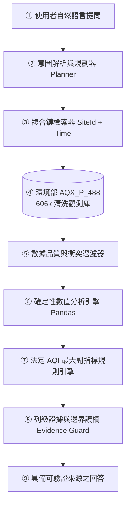

# AirGuard AI: 台灣空氣品質確定性證據分析代理人
**Taiwan Air Quality Evidence Agent for Traceable Local Air-Quality Analysis**

[](https://github.com/Fission-AI/OpenSpec)
[](https://opensource.org/licenses/MIT)
[](https://www.python.org/)

---

## 📌 專案簡介 (Overview)
AirGuard AI 是一個專門針對台灣環境部逐時空氣品質歷史資料（AQX_P_488）設計的**領域智慧代理人 (Domain Evidence Agent)**。
本專題嚴格遵循 **「語言理解與數值計算分離」** 原則，徹底解決大語言模型在空品問答中的數值計算幻覺與缺乏引用來源問題，實現 100% 逐列可驗證 (Row-Level Provenance) 的在地化空氣品質分析。

---

## 🏛️ 核心架構與五層解耦 (Architecture)


---

## 📂 專案檔案結構 (Project Structure)
```text
├── openspec/                         # OpenSpec 規範驅動開發 (SDD) 規格目錄
│   ├── specs/                        # 系統單一事實來源 (SSOT)
│   │   ├── data-pipeline.md          # 數據清洗與衝突隔離規範
│   │   ├── agent-architecture.md     # 代理人解耦架構規範
│   │   ├── domain-rules.md           # 法定 AQI 算則與安全防線規範
│   │   └── evaluation-benchmark.md   # 60 題基準評估與指標規範
│   └── changes/                      # 變更提案 (Delta Proposals)
├── doc/                              # 課堂原始規範與參考文件
│   ├── A2Z outline example.pdf       # 2020 A-Z SOP 規範
│   ├── 期末專題提案作業規範.pdf      # 期末提案作業指標
│   └── 1.NBLM output 熱量AI提案解析.pdf
├── DESIGN.md                         # 系統設計工程文件
├── Proposal_Refactored.md            # 完整重構提案書 (A-Z SOP 規格)
├── Proposal.pdf                      # 專題提案書 PDF 格式
├── Proposal.pptx                     # 專題提案簡報 (20 頁)
├── AirGuard_AI_NBLM_Analysis.md      # NotebookLM 審查深度解析報告
├── AirGuard_AI_Infographic_Blueprint.md # A4 橫式高密度圖表生成提示詞與藍圖
├── AirGuard_AI_Infographic.png       # ChatGPT 生成之 A4 橫式資訊圖表 (2.39 MB)
└── README.md                         # 本專案說明文件
```

---

## 🚀 快速上手 (Quick Start)

### 1. 安裝環境與相依套件
```bash
# 安裝 OpenSpec CLI
npm install -g @fission-ai/openspec@latest

# 安裝 Python 相依套件
pip install pandas pypdf python-docx python-pptx
```

### 2. 驗證 OpenSpec 規格
```bash
openspec validate proposal-refactor
```

---

## 👥 專案組員 (Team Members)
- 許景翔、李君衛、吳誠哲
- 提案日期：2026 年 11 月
