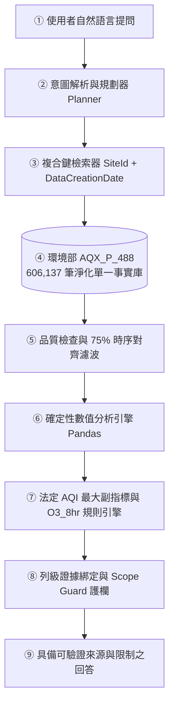

# AirGuard AI: 台灣空氣品質確定性證據分析代理人
**AirGuard AI: A Deterministic and Row-Level Provenance-Grounded Conversational Agent for Taiwan Air Quality Analysis**

[](https://github.com/Fission-AI/OpenSpec)
[](https://opensource.org/licenses/MIT)
[](https://www.python.org/)

---

## 📌 專案簡介 (Overview)
**AirGuard AI** 是一個針對台灣環境部逐時空氣品質歷史資料（`AQX_P_488`）設計的**確定性證據型領域智慧代理人（Domain Evidence Agent）**。
本專題嚴格遵循 **「LLM 負責意圖解析與語意組織，確定性工具負責檢索與計算，法定規則與護欄負責邊界檢查」** 原則，徹底解決大語言模型在空品問答中的表格計算幻覺與缺乏引用依據問題，實現 100% 列級可追溯（Row-Level Provenance）的台灣在地化空氣品質分析。

> **提案階段註記**：目前所有實驗評估目標（`AirGuard-Eval-60`）皆為提案規劃驗證基準（Expected Outcomes），尚未包含已執行之實測數據。

---

## 🆕 本次作業更新摘要 (Updated Course Deliverables)
依據最新課堂需求更新，本 Repository 已補齊並驗證以下核心內容：
1. **IEEE Transactions 期刊格式摘要**（`Proposal_Refactored.md` 第三部分）：依 *IEEE Transactions on Systems, Man, and Cybernetics: Systems* 格式撰寫 `Title—`、`Abstract—` 與 `Index Terms—`。
2. **Perplexity 實證強化 A–F 摘要與學術價值整理**（`Proposal_Refactored.md` 第一／二部分）：納入 *State of Global Air 2025*（790 萬死亡）、WHO 2025 `B09461`（99% 人口超標）、台灣環境部 **2025 年 1 月 1 日生效之 $\text{PM}_{2.5}\ 12\ \mu\text{g/m}^3$ 新制與「站站達標」／午後臭氧橘色提醒案例**，以及 *TableBench*／*RAGTruth* 實證文獻。
3. **300 字重點精華摘要**：彙整 A–F 完整研究脈絡為精煉中文摘要。
4. **OpenSpec SDD 規範轉換與嚴格驗證**：將 `DESIGN.md` 轉換為標準 `<capability>/spec.md` 目錄結構與九階段工作流，通過 `openspec validate --all --strict` 5/5 零錯誤驗證。

---

## 🏛️ 核心架構與九階段解耦工作流 (Architecture)


---

## 📂 專案檔案結構 (Project Structure)
```text
├── openspec/                                 # OpenSpec 規範驅動開發 (SDD) 規格目錄
│   ├── config.yaml                           # OpenSpec 專案脈絡與規則設定
│   ├── specs/                                # 系統單一事實來源 (SSOT, <capability>/spec.md)
│   │   ├── data-pipeline/spec.md             # 970k->606k 資料清洗、4 站修復與 13 組衝突隔離規範
│   │   ├── agent-architecture/spec.md        # 語意與計算嚴格解耦架構規範
│   │   ├── domain-rules/spec.md              # 法定 AQI 最大副指標、75% 覆蓋與安全拒答規範
│   │   └── evaluation-benchmark/spec.md      # 60 題基準評估與學術誠信規範
│   └── changes/proposal-refactor/            # 提案重構變更提案與工作流轉換
│       ├── proposal.md                       # 變更動機與更新範圍
│       ├── design.md                         # DESIGN.md 轉換之九階段 OpenSpec 工作流
│       ├── specs/proposal-refactor/spec.md   # 提案結構與最新作業需求 Delta Spec
│       └── tasks.md                          # 實作與驗證檢核清單
├── .agents/                                  # OpenSpec Antigravity Skills 與 Workflows
├── doc/                                      # 課堂原始規範、作業樣本與參考文件
│   ├── A2Z outline example.pdf               # 2020 A-Z SOP 結構規範
│   ├── 期末專題提案作業規範.pdf              # 期末專題作業指標與評分標準
│   ├── 期中Proposal_熱量AI_Agent.docx        # 教師課堂範例 (DietSense)
│   ├── DietSense_Proposal_Presentation.pptx  # 教師課堂範例簡報
│   ├── 1.NBLM output 熱量AI提案解析.pdf      # 課堂範例 NBLM 輸出參考
│   └── 2.DietSense資訊圖表.png               # 課堂範例資訊圖表參考
├── DESIGN.md                                 # 系統工程設計文件 (與 OpenSpec 雙向對齊)
├── Proposal_Refactored.md                    # 完整重構提案書 (IEEE 摘要 + Perplexity A-F + 300字摘要 + G-L + M-O + Deep Research + PA-PM + Q-V + W-Z + References)
├── AirGuard_AI_NBLM_Analysis.md              # NotebookLM 規範深度審查報告
├── AirGuard_AI_Infographic_Blueprint.md      # A4 橫式高密度資訊圖表文字藍圖與提示詞
├── AirGuard_AI_Infographic.png               # A4 橫式資訊圖表 (2.39 MB)
├── chatgpt_prompt.txt                        # 資訊圖表生成完整 Prompt
├── Proposal.pdf                              # 原始初版專題提案 PDF (更新彙整請以 Proposal_Refactored.md 為準)
├── Proposal.pptx                             # 原始初版專題提案簡報 (20 頁)
└── README.md                                 # 本專案說明文件
```

---

## 🚀 快速上手 (Quick Start)

### 1. 安裝環境與 OpenSpec CLI
```bash
# 安裝 OpenSpec CLI
npm install -g @fission-ai/openspec@latest

# 安裝 Python 文件處理參考套件 (選用)
pip install pandas pypdf python-docx python-pptx
```

### 2. 驗證 OpenSpec 規格與工作流
```bash
openspec list --specs
openspec validate --all --strict
```

---

## 👥 專案組員 (Team Members)
- 許景翔、李君衛、吳誠哲
- 提案更新日期：2026 年 11 月
