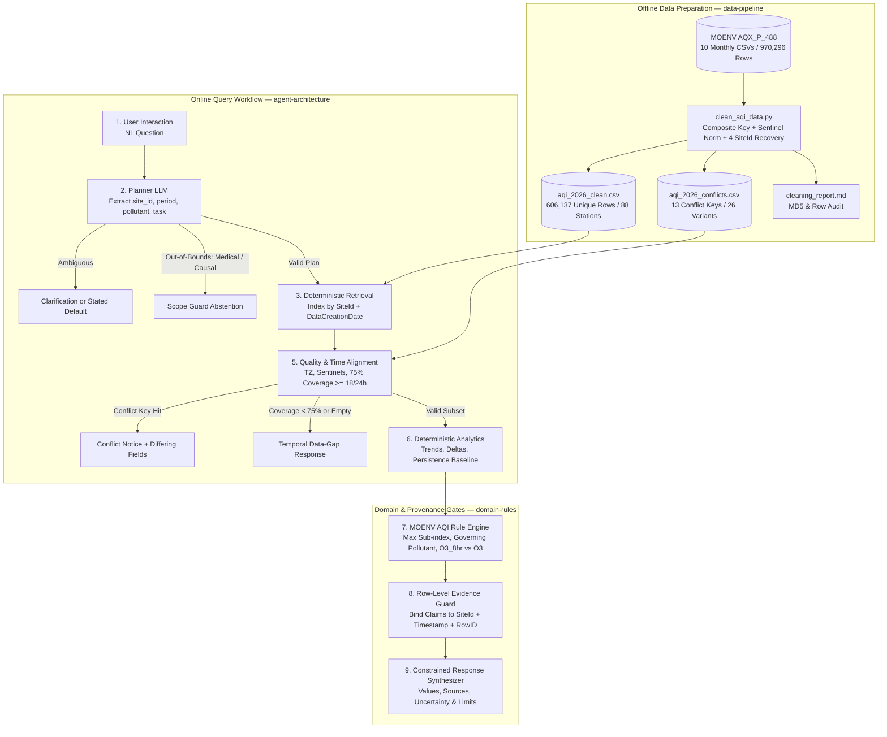

# Design: Converting `DESIGN.md` into an OpenSpec SDD Workflow

## Context
See `proposal.md` for motivation and updated course deliverables. `DESIGN.md` defines AirGuard AI's offline MVP for Taiwan MOENV AQX_P_488 hourly air-quality QA (2026-01-01 to 2026-10-29 16:00; 970,296 raw rows audited to 606,137 unique observations across 88 stations with 13 conflicting `(SiteId, DataCreationDate)` keys quarantined). This design translates `DESIGN.md` into a spec-driven operational workflow governed by the four canonical capabilities in `openspec/specs/`.

## Goals / Non-Goals

**Goals:**
- Map every module and policy in `DESIGN.md` (`Sections 3–12`) to testable requirements in `openspec/specs/{data-pipeline,agent-architecture,domain-rules,evaluation-benchmark}/spec.md`.
- Encode a deterministic 9-stage query-execution workflow with explicit quality, conflict, coverage, and scope-abstention gates.
- Ensure all proposal artifacts (`Proposal_Refactored.md`, `AirGuard_AI_NBLM_Analysis.md`, `README.md`) share one synchronized single source of truth (SSOT).

**Non-Goals:**
- Live MOENV `AQX_P_432` streaming ingestion or low-cost IoT (`AirBox`) sensor fusion in the MVP evaluation loop.
- End-to-end LLM arithmetic computation, missing-value interpolation, causal pollution attribution, or individualized clinical advice.

## Operational Workflow (Converted from `DESIGN.md`)

### Module-to-OpenSpec Capability Mapping
| `DESIGN.md` Stage / Module | OpenSpec Spec Capability | Deterministic Gate / Artifact |
|---|---|---|
| ④ MOENV Dataset & §7 Data Handling | `data-pipeline` | `scripts/clean_aqi_data.py`, `aqi_2026_clean.csv`, `aqi_2026_conflicts.csv` |
| ①–③, ⑥, ⑧–⑨ Query-Response Loop | `agent-architecture` | Structured Planner JSON, Pandas stats dict, `supporting_rows` provenance check |
| ⑤ Quality/Time & ⑦ Domain Rules | `domain-rules` | 75% daily coverage check, `O3_8hr` vs `O3` isolation, max sub-index, scope abstention |
| §11 Evaluation Plan | `evaluation-benchmark` | 60-question benchmark (`AirGuard-Eval-60`), 3-condition comparison, 0.0% unsupported-claim target |

## Decisions

1. **Decoupled Planner + Fixed Python Tools vs. Autonomous Code-Generating Multi-Agent (e.g., Neuro-Air)**
   - *Decision*: Restrict the LLM to structured parameter parsing and constrained response wording; execute all retrieval and math via fixed, unit-tested Python functions.
   - *Rationale*: Eliminates floating-point hallucination and non-deterministic code-execution drift while guaranteeing 100% row-level provenance.
   - *Alternative Considered*: Multi-agent sandbox Python generation; rejected for MVP due to higher audit complexity and risk of silently interpolating missing hours.

2. **Frozen Offline Historical Snapshot (`AQX_P_488`) vs. Live API (`AQX_P_432`)**
   - *Decision*: Evaluate strictly against the audited 2026-01 to 2026-10-29 snapshot (`606,137` rows).
   - *Rationale*: Guarantees full reproducibility across the 3 experimental conditions without transient API outages or unverified live-stream revisions.

3. **Official MOENV Reference Stations (`TAQMN`) vs. Crowdsourced IoT (`AirBox`)**
   - *Decision*: Keep official MOENV records as Tier-1 SSOT and exclude uncalibrated low-cost sensors from MVP ground truth.
   - *Rationale*: Peer-reviewed 2025 studies (Dong et al., Fang et al., Lekamge & Oswin) confirm humidity scattering, optical drift, and cross-site overfitting in low-cost sensors.

## Risks / Trade-offs
- **Partial-Year Coverage (Jan–Oct 2026)** → Mitigation: Explicitly restrict conclusions to the audited 10-month window and forbid annual or full-winter generalization claims.
- **`DataCreationDate` Temporal Semantics** → Mitigation: Retain original field semantics and disclose verification pending MOENV documentation before renaming to physical observation time.
- **Ambiguous Station Names (e.g., 中文/英文別名)** → Mitigation: Enforce `SiteId` primary-key resolution and ask clarification rather than fuzzy-joining on `SiteName`.
- **Proposal-Stage Target Confusion** → Mitigation: Label all planned benchmark metrics (`AirGuard-Eval-60`) strictly as expected targets rather than completed empirical findings.

## Verification Workflow
1. Run `openspec validate --all --strict --json` to verify all 4 canonical specs (`openspec/specs/*/spec.md`) and the `proposal-refactor` change pass with zero errors or warnings.
2. Cross-audit `Proposal_Refactored.md`, `DESIGN.md`, `AirGuard_AI_NBLM_Analysis.md`, and `README.md` for consistent counts (`970,296`, `606,137`, `88`, `13`, `4`, `60`) and verified reference DOIs/URLs.
