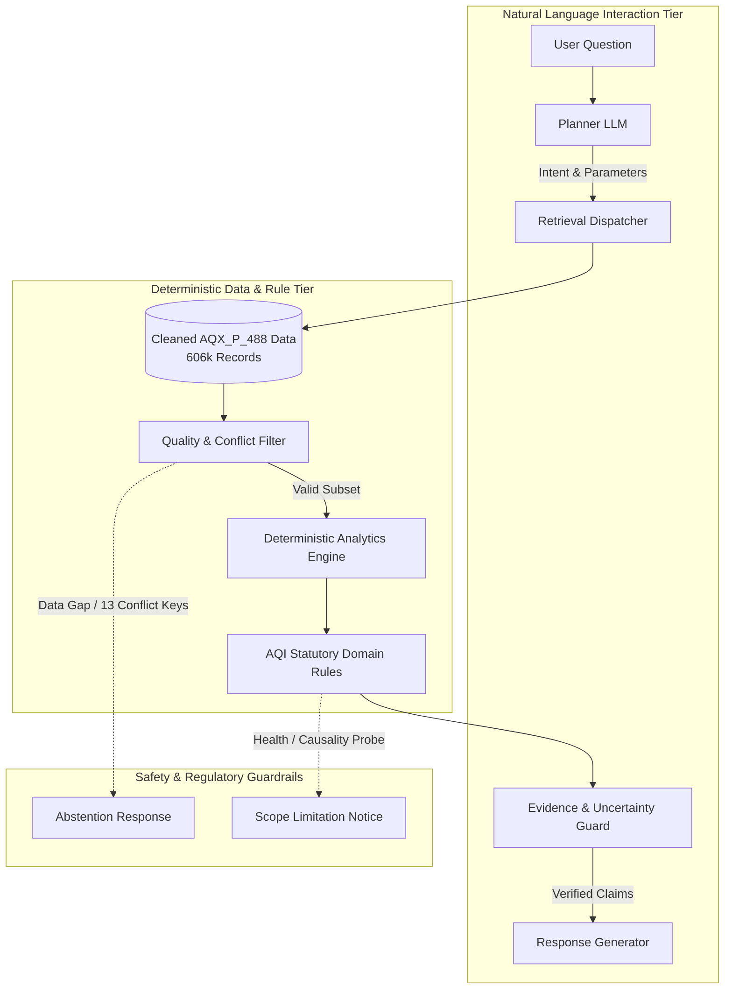

# Design: Refactored System Architecture and Workflow

## Context
AirGuard AI is a domain-specific evidence agent that performs deterministic local air quality analysis for Taiwan using Ministry of Environment (MOENV) hourly historical records (AQX_P_488).

## Architectural Flow

## Module Implementation Mapping
1. **Planner**: Translates query into `{site_id, time_range, pollutant, task_type}`.
2. **Retrieval Dispatcher**: Filters `data/processed/aqi_2026_clean.csv` by indexed composite key `(SiteId, DataCreationDate)`.
3. **Quality & Conflict Filter**: Checks for null sentinels, missing intervals, and ensures query does not hit excluded conflict records (`aqi_2026_conflicts.csv`).
4. **Deterministic Analytics Engine**: Computes exact mathematical aggregations, moving averages, station differences, and rankings without neural hallucination.
5. **AQI Statutory Domain Rules**: Applies official Taiwan MOENV piecewise formulas for sub-indices and identifies governing max pollutant.
6. **Evidence Guard**: Cross-verifies that every number in candidate output matches an exact row in the retrieved record table.
7. **Response Generator**: Formulates concise, professional explanations citing station, timestamp, numeric observation, and domain caveats.
